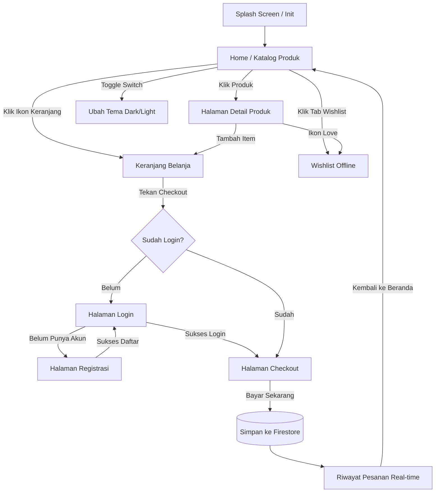

# Product Requirements Document (PRD)
## Mini E-Commerce Mobile Application (*Continuous Capstone Project*)

* **Versi Dokumen:** 1.0.0
* **Status:** Approved / Ready for Implementation
* **Target Pengguna & Pengembang:** Siswa SMK (PPLG / RPL / SIJA) & Instruktur Bootcamp
* **Tema Master Project:** *KicksStore* (Toko Sneakers & Sepatu Online)
* **Dokumen Acuan Terkait:** [SILABUS_REKONSTRUKSI_FLUTTER_12_SESI.md](file:///Users/rafiyandi/Downloads/sanbercode/SMK/docs/SILABUS_REKONSTRUKSI_FLUTTER_12_SESI.md)
* **Arsitektur:** GetX Pattern (MVVM: Module, Binding, Controller, View, Route)

---

## 1. Ringkasan Eksekutif & Tujuan Produk

### 1.1 Latar Belakang
Dalam pelatihan Flutter intensif 12 sesi, siswa membutuhkan proyek riil berskala industri yang mencakup seluruh pilar pengembangan aplikasi mobile modern: navigasi, manajemen state reaktif, integrasi REST API, penyimpanan lokal (*offline-first*), autentikasi cloud, hingga database *real-time*.

### 1.2 Tujuan Produk
Membangun aplikasi **Mini E-Commerce** yang fungsional dari hulu ke hilir (*end-to-end*): mulai dari penjelajahan katalog produk, manajemen keranjang belanja, penyimpanan barang favorit offline, autentikasi pembeli, hingga proses checkout dan riwayat pesanan cloud yang tersinkronisasi secara langsung.

### 1.3 Batasan Produk (*Scope & Non-Goals*)
* **In-Scope:**
  * Penjelajahan katalog produk online (REST API DummyJSON).
  * Pencarian produk dengan teknik *debounce* & penyaringan berdasarkan kategori.
  * Keranjang belanja dinamis dengan kalkulasi harga reaktif.
  * Fitur Wishlist / Favorit offline menggunakan database lokal NoSQL (Hive CE).
  * Pengaturan tema aplikasi (*Dark Mode / Light Mode*) persisten via SharedPreferences.
  * Pendaftaran dan login akun pembeli menggunakan Firebase Authentication.
  * Proteksi halaman checkout (*Route Guard Middleware*).
  * Pencatatan transaksi belanja ke Google Cloud Firestore dengan pembaruan *real-time stream*.
  * Pembuatan file APK rilis mandiri (*split-per-abi*).
* **Non-Goals (Tidak Dikerjakan agar tidak over-complicated):**
  * Integrasi Payment Gateway nyata (Midtrans/Xendit) — dialihkan dengan simulasi metode bayar (COD / Transfer Bank).
  * Pelacakan kurir GPS real-time (Google Maps API).
  * Chat langsung penjual-pembeli.

---

## 2. Arsitektur Informasi & Alur Pengguna (*User Flow*)

### 2.1 Diagram Navigasi Halaman


---

## 3. Spesifikasi Kebutuhan Fungsional (*Functional Requirements*)

Setiap kebutuhan fungsional dipetakan secara presisi ke modul GetX CLI dan sesi pelatihan.

---

### FR-01: Modul Beranda & Katalog (`home`) — Sesi 01, 04, 05, 11
* **ID:** `FR-01-CATALOG`
* **Deskripsi:** Menampilkan daftar katalog produk dari server internet, fitur pencarian, filter kategori, dan tombol pengaturan tema.
* **Kebutuhan Teknis:**
  * **Layout:** `GridView.builder` 2 kolom responsif.
  * **Komponen Kartu Produk (`ProductCard`):** Gambar thumbnail, judul produk (maksimal 2 baris dengan ellipsis), chip kategori, harga berformat Rupiah, indikator rating bintang, dan tombol cepat "Tambah ke Keranjang".
  * **Sumber Data:** HTTP GET `https://dummyjson.com/products` via Dio Client.
  * **UI States:**
    * *Loading:* Tampilan 6 kerangka abu-abu berkedip (*Shimmer Loading Skeleton*).
    * *Success:* Grid produk dengan foto dan teks asli.
    * *Error:* Ilustrasi koneksi terputus + teks pesan kesalahan + tombol CTA *"Coba Lagi"*.
    * *Empty:* Ilustrasi kotak kosong jika pencarian tidak membuahkan hasil.
  * **Search Bar & Filter Kategori:**
    * Input teks pencarian dengan *debounce* 500ms (memanggil endpoint `/products/search?q={query}`).
    * Deretan tombol chip kategori horizontal (All, Sneakers, Casual, Sports).
  * **Cart Badge:** Ikon keranjang di `AppBar` menampilkan lingkaran merah berisi jumlah total item belanja secara reaktif (`Obx`).

---

### FR-02: Modul Detail Produk (`detail`) — Sesi 02, 05
* **ID:** `FR-02-DETAIL`
* **Deskripsi:** Menyajikan informasi komprehensif tentang satu produk yang dipilih dan interaksi penambahan belanja.
* **Kebutuhan Teknis:**
  * Menerima argumen objek `ProductModel` melalui `Get.arguments`.
  * **Visual Antarmuka:**
    * Galeri gambar besar dengan rasio proporsional.
    * Nama produk, badge kategori, harga satuan, dan status stok ketersediaan.
    * Deskripsi lengkap produk dalam teks scrollable.
  * **Selector Kuantitas Reaktif:**
    * Tombol decrement (`-`) dengan validasi batas bawah minimal 1.
    * Angka kuantitas reaktif (`RxInt quantity = 1.obs`).
    * Tombol increment (`+`) dengan validasi batas atas tidak melebihi stok barang.
  * **Aksi Tombol Bawah (*Bottom Sticky Bar*):**
    * Tombol ikon hati (*Wishlist*): Berubah warna merah jika produk sudah ada di daftar favorit lokal.
    * Tombol "Tambah ke Keranjang": Menambahkan produk dengan kuantitas terpilih ke `CartController`, memicu notifikasi Snackbar sukses, dan memperbarui badge AppBar.

---

### FR-03: Modul Keranjang Belanja (`cart`) — Sesi 03, 08
* **ID:** `FR-03-CART`
* **Deskripsi:** Mengelola daftar item yang akan dibeli, kalkulasi total belanja secara otomatis, dan pintu masuk alur transaksi.
* **Kebutuhan Teknis:**
  * **Aturan Bisnis (*Business Logic*):**
    * Mencegah duplikasi: Jika produk dengan `id` yang sama ditambahkan kembali, sistem cukup menaikkan kuantitasnya (`quantity += newQty`).
    * Pengguna dapat mengubah kuantitas (+ / -) langsung dari kartu item di keranjang.
    * Jika kuantitas diturunkan hingga 0, sistem memunculkan dialog konfirmasi penghapusan item.
    * Tombol hapus (*swipe-to-dismiss* atau tombol tempat sampah) untuk membuang item.
  * **Kalkulasi Reaktif:**
    $$\text{Subtotal} = \sum (\text{Harga Item} \times \text{Kuantitas})$$
    $$\text{Grand Total} = \text{Subtotal} - \text{Diskon}$$
  * **Empty State:** Jika keranjang kosong, menampilkan ilustrasi belanja kosong dan tombol CTA *"Mulai Belanja"* yang mengarahkan kembali ke Beranda.
  * **Tombol "Lanjut ke Pembayaran":** Memicu rute navigasi menuju `/checkout`.

---

### FR-04: Modul Wishlist Offline (`wishlist`) — Sesi 06, 07
* **ID:** `FR-04-WISHLIST`
* **Deskripsi:** Menyimpan dan menampilkan daftar barang impian pengguna yang tersimpan di memori perangkat lokal dan dapat diakses tanpa koneksi internet (*Offline-First*).
* **Kebutuhan Teknis:**
  * **Penyimpanan Lokal:** Database NoSQL **Hive CE** dengan nama box `wishlist_box`.
  * **Model Kustom:** `WishlistModel` yang telah terdaftar dengan `TypeAdapter` (ID, judul, harga, thumbnail, category).
  * **Operasi CRUD:**
    * *Create:* `box.put(product.id, wishlistItem)`
    * *Read:* Mengambil semua entri via `box.values.toList()` saat aplikasi dibuka.
    * *Delete:* `box.delete(product.id)` saat ikon hati ditekan ulang.
  * **Kesiapan Offline:** Halaman Wishlist tetap dapat dibuka, dibaca, dan dihapus meskipun koneksi internet terputus atau ponsel dalam *Airplane Mode*.

---

### FR-05: Modul Autentikasi Pengguna (`login` & `register`) — Sesi 09
* **ID:** `FR-05-AUTH`
* **Deskripsi:** Menyediakan sistem registrasi dan login pembeli berbasis cloud menggunakan Firebase Authentication.
* **Kebutuhan Teknis:**
  * **Registrasi Akun Baru (`/register`):**
    * Input: Nama Lengkap, Email, Password, Konfirmasi Password.
    * Validasi Form: Format email wajib valid (`@`), panjang password minimal 6 karakter, password dan konfirmasi harus cocok.
    * Eksekusi: `FirebaseAuth.instance.createUserWithEmailAndPassword(...)`.
  * **Login Akun Pembeli (`/login`):**
    * Input: Email dan Password.
    * Eksekusi: `FirebaseAuth.instance.signInWithEmailAndPassword(...)`.
    * Error Handling: Menampilkan pesan kesalahan informatif via GetX Snackbar jika password salah atau akun tidak ditemukan.
  * **Manajemen Sesi:**
    * Stream listener `authStateChanges()` pada `AuthController` global.
    * Auto-redirect: Jika login berhasil saat dalam alur belanja, pengguna otomatis dikembalikan ke halaman `/checkout`.
  * **Fitur Logout:** Menghapus sesi login aktif dengan dialog konfirmasi sebelum keluar.

---

### FR-06: Modul Checkout & Route Guard (`checkout`) — Sesi 08, 10
* **ID:** `FR-06-CHECKOUT`
* **Deskripsi:** Formulir konfirmasi pemesanan akhir dengan perlindungan hak akses login.
* **Kebutuhan Teknis:**
  * **Keamanan Rute (*GetX Route Middleware*):**
    * Jika pengguna belum login (`authController.isLoggedIn == false`), akses rute `/checkout` dicegat (*intercepted*) dan dialihkan ke `/login`.
  * **Formulir Pengiriman:**
    * Input Nama Penerima, Nomor WhatsApp/Telepon, Alamat Pengiriman Lengkap, dan Catatan Pesanan.
    * Pilihan Metode Pembayaran (Radio button: COD / Bayar di Tempat, Transfer Bank BCA/Mandiri).
  * **Ringkasan Belanja:** Menampilkan total item, rincian biaya, dan grand total.
  * **Tombol "Bayar Sekarang":** Memvalidasi form input, memicu pembuatan transaksi ke Firestore, lalu mengosongkan keranjang belanja.

---

### FR-07: Modul Riwayat Pesanan Real-time (`orders`) — Sesi 10
* **ID:** `FR-07-ORDERS`
* **Deskripsi:** Menampilkan riwayat transaksi belanja yang tersimpan di Google Cloud Firestore secara langsung (*real-time update*).
* **Kebutuhan Teknis:**
  * **Penyimpanan Cloud:** Menulis dokumen pesanan ke Firestore:
    ```dart
    FirebaseFirestore.instance.collection('orders').add(orderData);
    ```
  * **Struktur Data Dokumen Pesanan:**
    * `orderId` (Auto-generated Firestore Document ID)
    * `userId` (UID dari pembeli Firebase Auth)
    * `userEmail` (Email pembeli)
    * `items` (Array berisi daftar nama barang, qty, dan harga)
    * `totalAmount` (Nominal rupiah total belanja)
    * `shippingAddress` (Alamat pengiriman)
    * `paymentMethod` (COD / Transfer)
    * `status` (Teks status: "Diproses", "Dikirim", "Selesai")
    * `createdAt` (Firestore Timestamp server)
  * **Konsumsi Data Real-time:** Menggunakan Firestore snapshot listener `snapshots()` yang di-binding ke variabel reaktif `RxList<OrderModel>` di `OrdersController`. Jika status pesanan diubah di Firebase Console, UI ponsel langsung berubah seketika tanpa perlu refresh manual.

---

### FR-08: Preferensi Tema & Personalisasi — Sesi 06
* **ID:** `FR-08-THEME`
* **Deskripsi:** Pengaturan tema aplikasi (*Dark Mode*) yang persisten.
* **Kebutuhan Teknis:**
  * Saklar (*Switch*) tema pada header atau menu pengaturan.
  * Nilai boolean tema disimpan menggunakan `SharedPreferences.setBool('is_dark_mode', value)`.
  * Saat aplikasi dimulai di `main.dart`, preferensi dibaca dan diaplikasikan langsung melalui `GetMaterialApp(themeMode: ...)`.

---

## 4. Kontrak Data & Skema Entitas (*Data Schemas*)

### 4.1 Skema Data REST API (DummyJSON $\rightarrow$ `ProductModel`)
```json
{
  "id": 1,
  "title": "Air Jordan 1 Retro High",
  "description": "Sepatu sneakers legendaris dengan material kulit premium.",
  "category": "mens-shoes",
  "price": 149.99,
  "rating": 4.85,
  "stock": 24,
  "thumbnail": "https://cdn.dummyjson.com/products/images/mens-shoes/1/thumbnail.png"
}
```

### 4.2 Skema Data Hive CE (`WishlistModel` - NoSQL Lokal)
```dart
@HiveType(typeId: 0)
class WishlistModel extends HiveObject {
  @HiveField(0) final int id;
  @HiveField(1) final String title;
  @HiveField(2) final double price;
  @HiveField(3) final String thumbnail;
  @HiveField(4) final String category;

  WishlistModel({
    required this.id,
    required this.title,
    required this.price,
    required this.thumbnail,
    required this.category,
  });
}
```

### 4.3 Skema Data Firestore (`orders` Collection - Cloud NoSQL)
```json
{
  "orderId": "ORD-20261020-001",
  "userId": "firebase_auth_uid_12345",
  "userEmail": "siswa@smk.sch.id",
  "customerName": "Budi Santoso",
  "shippingAddress": "Jl. Merdeka No. 45, Jakarta",
  "paymentMethod": "COD",
  "items": [
    {
      "productId": 1,
      "title": "Air Jordan 1 Retro High",
      "price": 1500000,
      "quantity": 2,
      "subtotal": 3000000
    }
  ],
  "totalAmount": 3000000,
  "status": "Diproses",
  "createdAt": "2026-10-20T00:30:00Z"
}
```

---

## 5. Standar Desain Sistem & Kriteria Tampilan (*UI/UX Guidelines*)

* **Palet Warna Utama:**
  * Primary Brand: Indigo Modern (`#4F46E5`)
  * Secondary / Accent: Amber Gold (`#F59E0B`)
  * Background Light: Cool Off-White (`#F8FAFC`)
  * Surface Card Light: Murni Putih (`#FFFFFF`) dengan elevasi halus (shadow 0.05 opacity).
  * Background Dark: Dark Slate (`#0F172A`)
  * Surface Card Dark: Dark Slate Card (`#1E293B`)
* **Tipografi:** Google Font *Inter* atau font sistem bawaan yang bersih, terbaca dengan kontras rasio minimal 4.5:1 (WCAG AA).
* **Format Mata Uang:** Format rupiah seragam menggunakan `intl`: `NumberFormat.currency(locale: 'id_ID', symbol: 'Rp ', decimalDigits: 0)`.

---

## 6. Kebutuhan Non-Fungsional (*Non-Functional Requirements*)

1. **Performa:** Render antarmuka berjalan stabil pada kecepatan 60 FPS tanpa jank pada saat scroll katalog panjang.
2. **Kinerja Jaringan:** Request API menggunakan timeout 10 detik dengan pesan error yang jelas jika koneksi pengguna lambat (*slow network*).
3. **Penyimpanan Lokal Ringan:** Database Hive CE beroperasi secara *in-memory binary storage*, menghasilkan waktu baca data wishlist di bawah 10 millisecond.
4. **Ukuran File APK Rilis:** Kompilasi dengan parameter `--split-per-abi` menghasilkan ukuran APK maksimal **25 MB** per arsitektur (ramah kuota internet siswa SMK).

---

## 7. Matriks Keterlacakan (*Traceability Matrix: PRD to Syllabus Sessions*)

| Kode Kebutuhan (FR) | Fitur / Komponen | Modul Get CLI | Sesi Pelatihan |
| :--- | :--- | :--- | :---: |
| **FR-01** | Katalog Produk & Layout Statis | `home` | **Sesi 01** |
| **FR-02** | Reaktivitas Counter & Detail Produk | `detail` | **Sesi 02** |
| **FR-03** | Manajemen Keranjang & Kalkulasi MVVM | `cart` | **Sesi 03** |
| **FR-01** | Koneksi Jaringan REST API & Dio Client | Layer Data `data/` | **Sesi 04** |
| **FR-01, FR-02** | Parsing ProductModel & UI State (Shimmer/Error) | `home`, `detail` | **Sesi 05** |
| **FR-08** | Persistensi Tema SharedPreferences & Hive Init | `home`, `main.dart`| **Sesi 06** |
| **FR-04** | CRUD Wishlist Offline NoSQL Hive CE | `wishlist` | **Sesi 07** |
| **FR-03, FR-06** | Logika Bisnis Keranjang & Middleware Route Guard| `cart`, `checkout` | **Sesi 08** |
| **FR-05** | Firebase Auth Pendaftaran & Login Pengguna | `login`, `register`| **Sesi 09** |
| **FR-07** | Cloud Firestore Riwayat Transaksi Real-time | `orders`, `checkout`| **Sesi 10** |
| **FR-01** | Fitur Pencarian Debounce, Kategori, & Polish UX | `home`, All views | **Sesi 11** |
| **FR-08** | Custom App Icon & Build APK Rilis Mandiri | Packaging | **Sesi 12** |

---

## 8. Kriteria Penerimaan Produk Akhir (*Acceptance Criteria / Definition of Done*)

Master Project dinyatakan selesai dan siap diajarkan jika memenuhi kriteria berikut:
1. [ ] Seluruh 7 modul ter-generate rapi menggunakan GetX CLI tanpa ada struktur file yang keluar dari pola standar.
2. [ ] Katalog produk berhasil mengambil data dari internet dan menampilkan visual *Shimmer*, *Success*, dan *Error* secara konsisten.
3. [ ] Kuantitas belanja dan badge keranjang belanja reaktif seketika saat tombol ditekan.
4. [ ] Fitur Wishlist dapat dibuka dan dioperasikan secara penuh saat perangkat dalam kondisi *Airplane Mode*.
5. [ ] Tombol Checkout berhasil mengarahkan pengguna belum login ke layar Login (*Route Guard*).
6. [ ] Pengguna dapat mendaftar dan masuk menggunakan akun email/password nyata via Firebase.
7. [ ] Data pesanan yang dibuat berhasil masuk ke Firestore dan langsung muncul secara realtime di halaman Riwayat Pesanan.
8. [ ] File APK rilis berhasil di-generate melalui `flutter build apk --split-per-abi` dan dapat dipasang di perangkat Android fisik.
